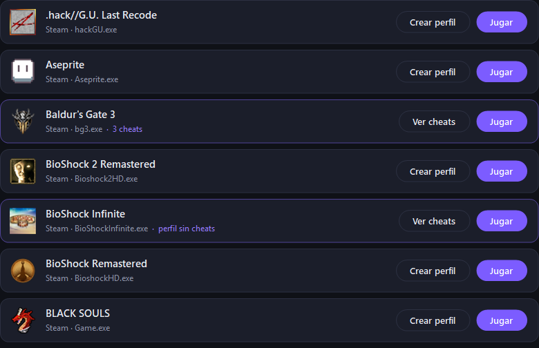
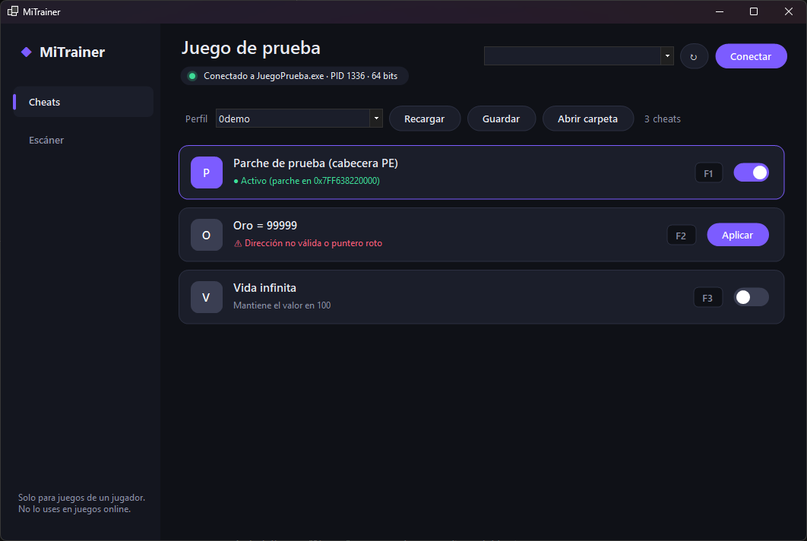
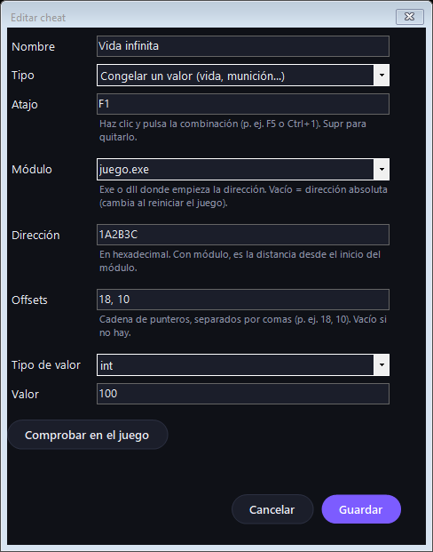

# MiTrainer

Trainer de cheats para juegos **de un jugador** en Windows, al estilo de Wand: detecta tus juegos,
activa cheats con atajos de teclado mientras juegas, y trae escáner de valores, escáner de punteros
y editor de cheats. Hecho en C# / .NET 10 / WinForms.

> No lo uses en juegos online: el anti-cheat lo detecta y te banean.



| Cheats | Editor |
|---|---|
|  |  |

## Empezar

```bash
dotnet run --project src/MiTrainer.App
```

Para practicar, abre el juego de prueba en otra terminal y sigue la [guía de uso](docs/guia-de-uso.md):

```bash
dotnet run --project samples/JuegoPrueba
```

## Pruebas

```bash
dotnet test MiTrainer.slnx
```

## Estructura

| Carpeta | Qué hay |
|---|---|
| `src/MiTrainer.Core` | Lógica pura: escáneres, punteros, cheats, sesión del trainer (sin Windows) |
| `src/MiTrainer.Infrastructure` | Windows: memoria de procesos, tiendas de juegos, archivos JSON |
| `src/MiTrainer.App` | La interfaz (WinForms) |
| `tests/` | Pruebas xUnit, una por capa |
| `samples/JuegoPrueba` | "Juego" de consola para practicar y para las pruebas |
| `docs/` | [Documentación](docs/README.md): arquitectura, motor de memoria, formatos, decisiones |
