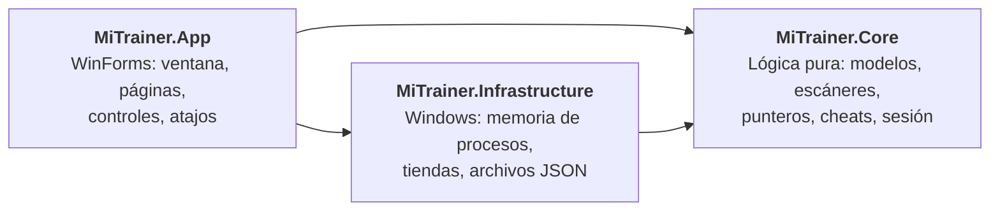
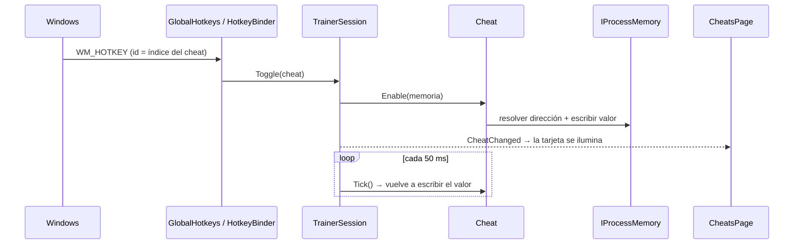

# Arquitectura

MiTrainer es una aplicación de escritorio para Windows que modifica la memoria de juegos **de un jugador**
(vida infinita, dinero, parches de código). Está organizada en **tres capas** con una regla simple:
las dependencias solo apuntan hacia dentro, hacia `Core`.



| Proyecto | Depende de | Contiene | No puede |
|---|---|---|---|
| `MiTrainer.Core` | nada (solo .NET) | Modelos, algoritmos e **interfaces** (`IProcessMemory`, `IProcessConnector`, `IGameStore`, repositorios) | Usar la API de Windows, el registro, archivos ni WinForms |
| `MiTrainer.Infrastructure` | Core | **Implementaciones** de esas interfaces para Windows | Tener lógica del trainer ni interfaz |
| `MiTrainer.App` | Core + Infrastructure | Ventanas, páginas, controles dibujados, atajos globales y la **raíz de composición** (`Program.cs`) | Leer memoria o archivos directamente: siempre a través de Core |

Gracias a esto, casi toda la lógica (escáneres, punteros, cheats, la sesión) se prueba con una **memoria falsa**
en milisegundos, sin juegos ni Windows (ver [Pruebas](pruebas.md)).

## Estructura de carpetas

```
MiTrainer/
├── MiTrainer.slnx               solución
├── Directory.Build.props        opciones comunes (nullable, avisos = errores)
├── docs/                        esta documentación
├── src/
│   ├── MiTrainer.Core/
│   │   ├── Values/              ValueKind (int/long/float/double), NumberText (hex, decimales)
│   │   ├── Memory/              IProcessMemory, regiones, módulos, BytePattern + PatternScanner (AOB)
│   │   ├── Scanning/            ValueScanner (primer/siguiente escaneo)
│   │   ├── Pointers/            PointerMap, PointerScanner, PointerPath, resultados guardables
│   │   ├── Cheats/              CheatDefinition, GameProfile, Cheat (en ejecución), IProfileRepository
│   │   ├── Games/               InstalledGame, IGameStore, GameLibrary
│   │   └── Trainer/             TrainerSession (el trainer en marcha), IProcessConnector
│   ├── MiTrainer.Infrastructure/
│   │   ├── Memory/              WindowsProcessMemory, WindowsProcessConnector, NativeMethods
│   │   ├── Games/               SteamStore, EpicStore, GogStore, ExecutableGuesser
│   │   └── Storage/             JsonProfileRepository, JsonPointerResultsRepository
│   └── MiTrainer.App/
│       ├── Program.cs           raíz de composición
│       ├── AppServices.cs       servicios que reciben las páginas
│       ├── Shell/               MainForm (menú, cabecera, latidos de la sesión)
│       ├── Pages/               GamesPage, CheatsPage, ScannerPage, PointersPage
│       ├── Dialogs/             CheatEditor
│       ├── Controls/            tarjetas, botones, interruptor, utilidades de maquetación
│       ├── Hotkeys/             atajos globales y su texto ("Ctrl+F2")
│       ├── Theming/             colores y fuentes
│       └── perfiles/            ejemplo.json
├── tests/                       pruebas xUnit (una por capa) + TestSupport (dobles de prueba)
└── samples/JuegoPrueba/         "juego" de consola para practicar y para las pruebas
```

## Piezas clave

### `IProcessMemory` — la única puerta al juego

Todo lo que toca la memoria del juego pasa por esta interfaz: leer, escribir, listar regiones y módulos.
Las direcciones son siempre `long`. Las operaciones de más alto nivel (leer un valor, seguir una cadena de
punteros, encontrar un módulo) son **métodos de extensión** en `ProcessMemoryExtensions`, así cualquier
implementación (la real o la falsa) las tiene gratis.

### `TrainerSession` — el trainer en marcha

Sabe a qué juego estamos conectados, qué perfil está abierto y el estado de cada cheat. No sabe nada de ventanas:
la interfaz **llama a sus métodos** y **escucha sus eventos**.

| Evento | Cuándo | Quién lo escucha |
|---|---|---|
| `ConnectionChanged` | Nos conectamos o el juego se cierra | Escáner (se reinicia), Punteros (carga los guardados), título |
| `ProfileChanged` | Se abre un perfil o cambian sus cheats | Cheats (tarjetas), Mis juegos (quién tiene perfil), atajos |
| `CheatChanged` | Un cheat se activa, falla... | La tarjeta de ese cheat |
| `StatusChanged` | Mensaje para la cabecera | La pastilla de estado |

La sesión necesita dos "latidos" que le da `MainForm`: `Tick()` cada 50 ms (mantener valores congelados) y
`Watch()` cada 1,5 s (detectar que el juego se cerró o se abrió y conectarse solo).

### Las páginas

Cada página es un `UserControl` independiente (`Pages/`) que recibe `AppServices` y **no conoce a las demás**.
Cuando una necesita llevar al usuario a otra, lanza un evento y `MainForm` hace de intermediario
(p. ej. `ScannerPage.PointerScanRequested` → `PointersPage.Prepare(...)`). La clase base `Page` trae un
temporizador que solo corre mientras la página está visible, para refrescar valores en directo sin gastar nada.

## Flujos

### Pulsar un atajo durante la partida



### Jugar desde «Mis juegos»

1. `GamesPage.Play` abre el perfil del juego (o uno temporal con su `.exe`) en la sesión y lanza el juego desde su tienda.
2. Cada 1,5 s `TrainerSession.Watch()` pregunta a `IProcessConnector` si el `.exe` del perfil ya está abierto.
3. Cuando aparece, la sesión se conecta y avisa con `ConnectionChanged`: los cheats ya se pueden activar.

### Cheats que sobreviven a reiniciar el juego

Escáner → «Buscar punteros» → `PointersPage` construye un `PointerMap` y busca hacia atrás con `PointerScanner`
→ los resultados se guardan solos → al reiniciar el juego se vuelve a encontrar el valor y se **filtra** →
la cadena buena se convierte en un cheat con módulo + offsets. Detalles en [Motor de memoria](motor-de-memoria.md).

## Cómo ampliar la app

| Quiero... | Dónde |
|---|---|
| Otra tienda de juegos (Xbox, EA...) | Una clase `IGameStore` en `Infrastructure/Games` y añadirla en `Program.cs`. Nada más cambia |
| Otro tipo de cheat | Un valor nuevo en `CheatType` (con su nombre JSON) y su caso en `Cheat.Enable/Disable`; el editor muestra sus campos |
| Otro tipo de valor (byte, short...) | `ValueKind` y sus extensiones en `ValueKinds` |
| Guardar perfiles en otro sitio | Otra implementación de `IProfileRepository` y elegirla en `Program.cs` |
| Una página nueva | Una clase que herede de `Page` y un `AddPage(...)` en `MainForm` |
| Cambiar colores o fuentes | `Theming/Theme.cs` |
